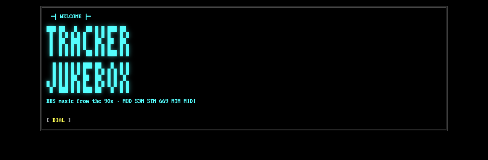
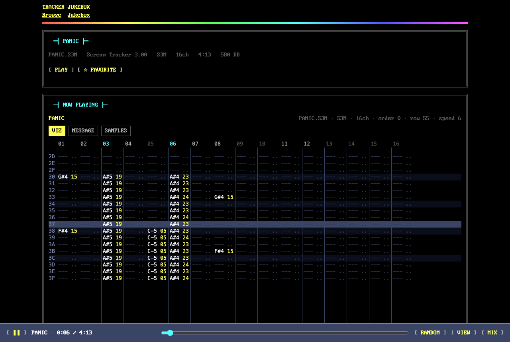
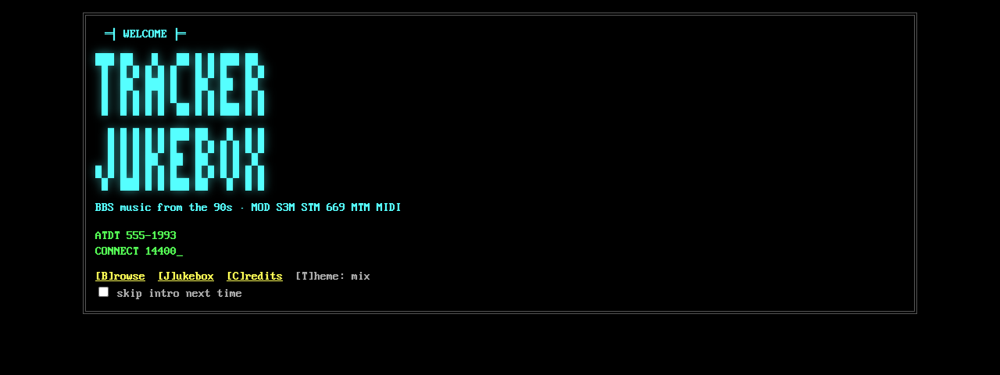
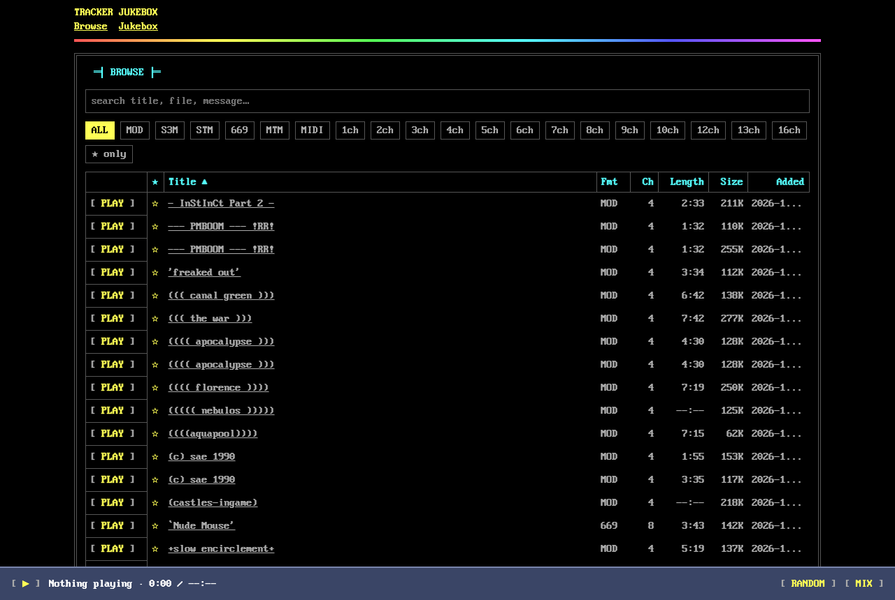
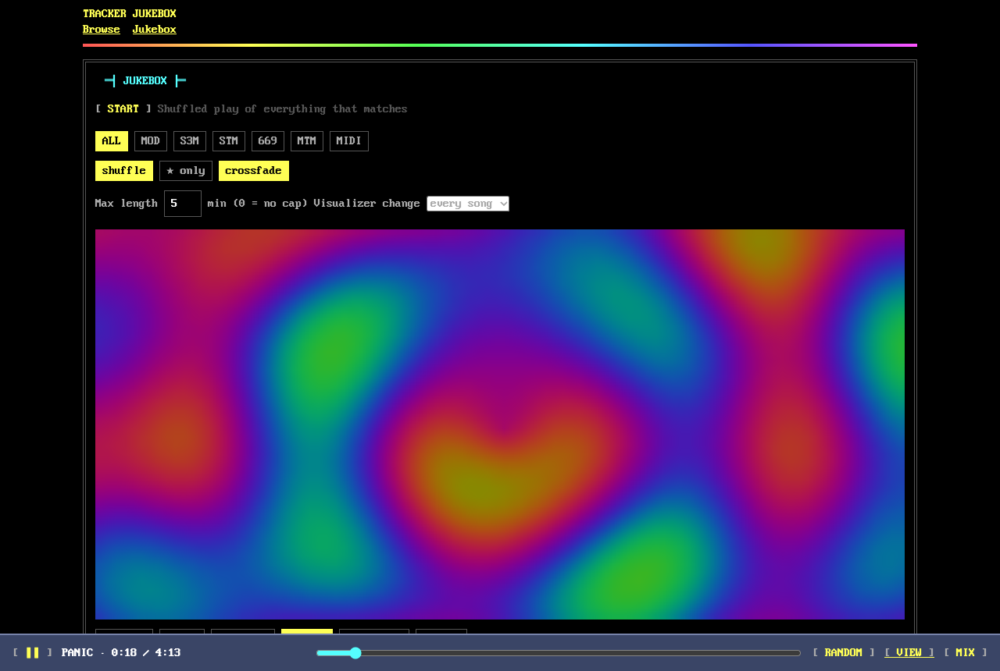
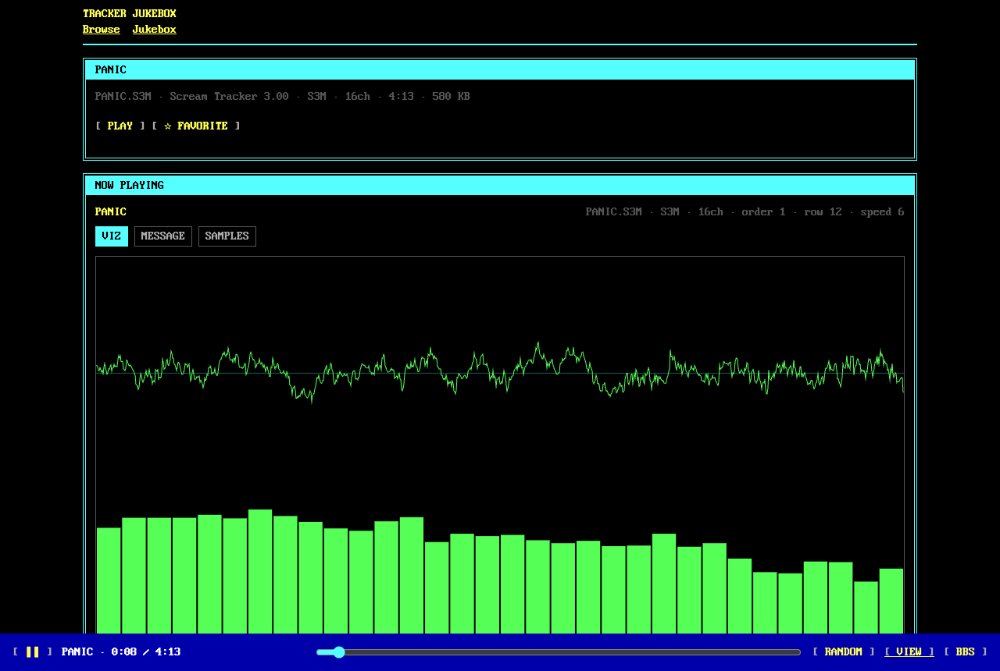
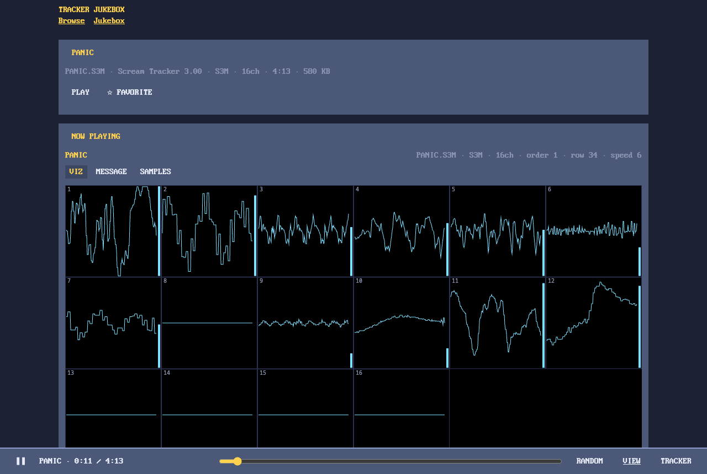
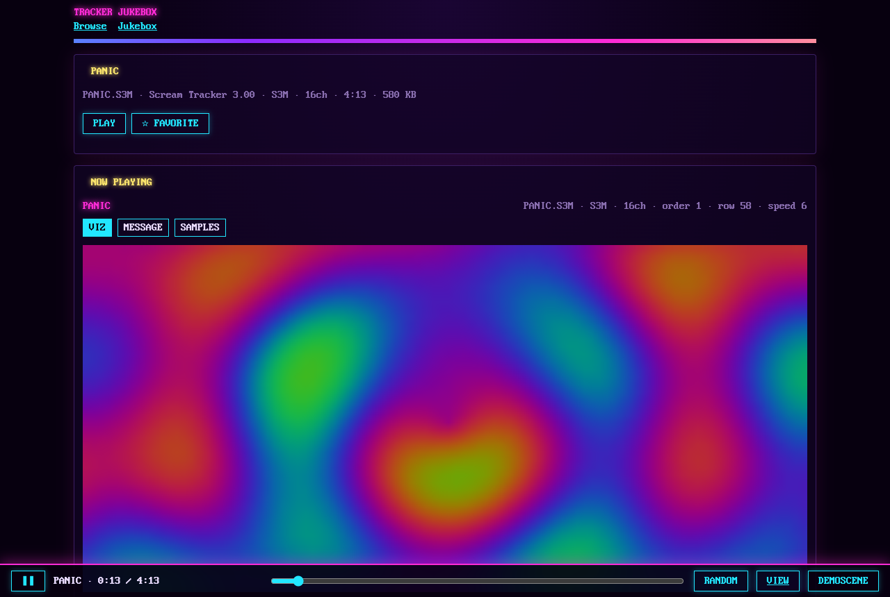

# Tracker Jukebox

A static website that plays 90s BBS music: tracker modules (MOD, S3M, STM, 669, MTM) and MIDI. Everything plays through our own player, written in TypeScript and run in an AudioWorklet. The site ships no third-party replayer. MP3 and FLAC files also play, through the browser's own decoder.



## Features

- **Our own engine.** Parsers for MOD, S3M, STM, 669, MTM and Standard MIDI files, a sequencer and mixer that handle each format's effect quirks, and an SF2 synth for MIDI (GeneralUser GS, with an MT-32 → GM program remap). Playback is authentic by default: no interpolation, full stereo. Both can be toggled.
- **MP3 and FLAC:** title, artist and length are read from the ID3 / Vorbis tags. They play through an `<audio>` element and crossfade with tracker songs in the jukebox. A beat detector on the bass drives the beat-reactive visualizers.
- **Browse** the whole library (~1,200 tracks). Search titles, file names and embedded messages; filter by format, channel count and favorites; sort by any column, including date added. Sort and filters are remembered; the list is paginated (25 / 50 / 100 per page).
- **Jukebox** mode: shuffled play with a format filter, favorites-only, crossfade, a length cap and an automatic visualizer change.
- **Player bar:** play/pause, previous/next (the jukebox queue, otherwise the Browse order), random, loop, favourite, seek. It wraps into rows on phones.
- **Visualizers (19):** a pattern view that shows the notes as the tracker wrote them (a piano roll for MIDI), scope + spectrum, per-channel scopes, classic spectrum bars, oscilloscope, spectrogram waterfall, 3D terrain, VU needles, MilkDrop-style warp, AVS superscope, swirl, tunnel, particles, radial spectrum, flowing waves, vectorscope, and plasma, starfield and copper-bar demo effects. Clicking a visualizer cycles its modes, and each one remembers its mode. `viz.config.json` switches visualizers on and off at build time.
- **Fullscreen visualizer:** the player bar auto-hides, a title card types in on each song change, and the screen is kept awake.
- **Song details:** the embedded message (sample names often carried BBS ads, greetings and phone numbers), a sample browser, per-channel mute and solo.
- **Four themes:** `bbs` (default), `tracker`, `demoscene` and `mix`.
- **Extras:** a dial-up modem intro, share links that start at a given position, media keys and lock-screen controls (Media Session), drag-and-drop of local files (on Browse and the song page), keyboard shortcuts.

## Screenshots

| Pattern view (bbs)                                   | Dial-up menu (mix)                                               |
| ---------------------------------------------------- | ---------------------------------------------------------------- |
|    |  |
| **Library browser**                                  | **Jukebox**                                                      |
|                |                          |
| **Scope + spectrum (bbs)**                           | **Channel scopes (tracker)**                                     |
|          |            |
| **Plasma (demoscene)**                               |                                                                  |
|  |                                                                  |

## Keyboard shortcuts

| Key             | Action                              |
| --------------- | ----------------------------------- |
| `Space`         | Play / pause                        |
| `←` / `→`       | Previous / next order (MIDI: ∓10 s) |
| `1`–`9`         | Mute / unmute channel               |
| `Shift`+`1`–`9` | Solo channel (`Shift`+`0` clears)   |
| `N`             | Next song (`Shift`: previous)       |
| `V`             | Next visualizer (`Shift`: previous) |
| `T`             | Next theme                          |
| `M`             | Show the current song's message     |
| `B` / `J` / `C` | Go to Browse / Jukebox / Credits    |
| `Esc`           | Leave the fullscreen visualizer     |

## Getting started

Requires Node **24.x** and pnpm **11.5.0**.

```sh
pnpm install
pnpm manifest          # trackers/ → public/music + public/manifest.json
pnpm fetch-soundfont   # downloads the GeneralUser GS SoundFont for MIDI
pnpm dev
```

### Local-only music

Put your own files in `trackers/private/`. It is gitignored, so they are never committed or deployed. `pnpm manifest` adds them to your local library, and keeps their date-added stamps in the gitignored `scripts/added.private.json`.

## Scripts

| Command                        | What it does                                                                  |
| ------------------------------ | ----------------------------------------------------------------------------- |
| `pnpm dev`                     | Vite dev server                                                               |
| `pnpm build`                   | Type-check and build to `dist/`                                               |
| `pnpm check`                   | `tsc`, ESLint, Prettier check and Vitest                                      |
| `pnpm format`                  | Prettier                                                                      |
| `pnpm manifest`                | Builds the library from `trackers/` (the only writer of `public/music`)       |
| `pnpm manage`                  | Local-only library manager: exclude files, override titles, pick MIDI targets |
| `pnpm render <file> [out.wav]` | Offline render of a song with our engine                                      |
| `pnpm compare [format\|id]`    | Compares our output against `openmpt123` (dev-only reference)                 |
| `pnpm fetch-soundfont`         | Downloads and checksums the SoundFont                                         |

## Project layout

```
src/
  formats/   file parsers (MOD, S3M, STM, 669, MTM, MIDI, SF2; MP3/FLAC headers)
  engine/    sequencer, effects, mixer, MIDI synth
  audio/     AudioEngine, AudioWorklet, modem intro
  library/   manifest, search, shuffle
  state/     React contexts, routing, settings
  viz/       visualizers
  ui/        pages, components, themes
scripts/     manifest, manage, render, compare, fetch-soundfont
trackers/    source music files (read-only); trackers/private/ is local-only
docs/        PLAN.md (the build plan) and screenshots
```

Imports only flow one way (`formats` → `engine` → `audio` → `state` → `ui`), and ESLint enforces it. `formats`, `engine` and `library` contain no React or DOM code, so the scripts reuse them in Node.

## Deployment

The site is fully static. `netlify.toml` builds it with `pnpm manifest && pnpm fetch-soundfont && pnpm build` and publishes `dist/`.

## Credits

- Font: Web437 IBM VGA 8x16 by VileR, [Oldschool PC Font Pack](https://int10h.org/oldschool-pc-fonts/), CC BY-SA 4.0.
- MIDI sound bank: [GeneralUser GS](https://www.schristiancollins.com) by S. Christian Collins.
- Music: by the original 90s authors. The in-app Credits page lists each song with its embedded message.
